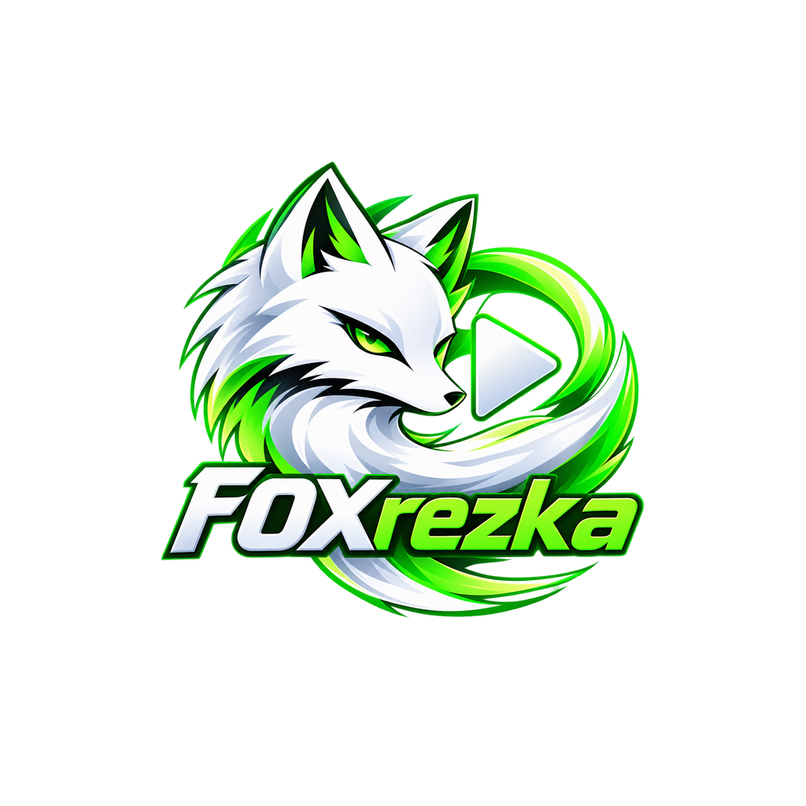

<div align="center">



#  FOXrezka

### Кино и сериалы — в одном Android-приложении

Лёгкий клиент для Rezka с поиском, каталогом и встроенным видеоплеером.

[**⬇ Скачать FOXrezka**](https://github.com/Latkovsky/FOXrezka/releases/latest)
&nbsp; · &nbsp;
[Исходный код](https://github.com/Latkovsky/FOXrezka)


</div>

---

## Возможности

| | |
|---|---|
| **Каталог** | Фильмы, сериалы, мультфильмы, аниме и дорамы. Подборки главной страницы загружаются с Rezka. |
| **Поиск** | Поиск доступен на главной и в каталоге; введённый запрос не восстанавливается после перезапуска и не переносится между вкладками. |
| **Просмотр** | Полноэкранный плеер с выбором качества, скорости и серии, переходом между сериями и цветовыми темами. |
| **Профиль** | История, продолжение просмотра, избранное и списки «Смотрю», «В планах», «Просмотрено» и «Заброшено». |
| **Настройки** | Темы приложения и плеера, проверка обновлений из GitHub Releases и ссылка на репозиторий. |

## Установка

**[Скачать FOXrezka 1.0.6 для Android](https://github.com/Latkovsky/FOXrezka/releases/latest)**

Скачайте APK из последнего релиза, откройте его на телефоне и подтвердите установку. При необходимости разрешите установку приложений из выбранного источника в настройках Android.

## Важно

- Подборки и доступные карточки зависят от содержимого сайта Rezka и могут меняться.
- Для загрузки постеров нужен доступ к `static.hdrezka.ac`; доступность видео зависит от сторонних CDN и сети.
- Набор озвучек и вариантов качества зависит от выбранного материала и аккаунта.
- История, продолжение просмотра и избранное хранятся на устройстве и не синхронизируются с аккаунтом Rezka.
- FOXrezka — независимый сторонний клиент, не связанный с администрацией Rezka.
- Репозиторий публичный, но лицензия не предоставлена. Публичный просмотр кода не означает разрешения на его использование или распространение.

<details>
<summary>Разработка и сборка</summary>

Для сборки нужны JDK 17, Rust, `cargo-ndk`, Android SDK (platform 34, build-tools 34, NDK 27) и Gradle 8.9.

```bash
./build.sh
```

Скрипт собирает Rust-ядро и APK для `arm64-v8a` и `x86_64`. Если подключён телефон с включённой USB-отладкой, APK устанавливается автоматически.

Для установки APK вручную:

```bash
adb install -r android/app/build/outputs/apk/debug/app-debug.apk
```

**Стек:** Kotlin · Jetpack Compose · AndroidX Media3 · Rust · UniFFI

</details>
